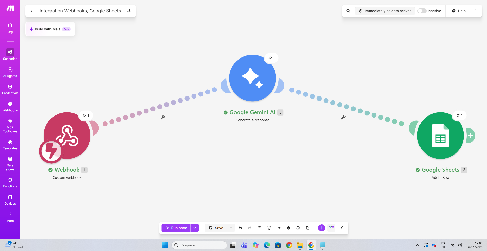

# 🛠️ Automação de Triagem de Chamados (HelpDesk com IA)

Este é um projeto prático que construí para automatizar a triagem de tickets de suporte técnico. A ideia é simples: em vez de um humano ler cada chamado para classificar a urgência, um script captura o problema, manda para uma Inteligência Artificial ler e analisar, e já salva tudo organizado em uma planilha.

O projeto foi feito integrando **PowerShell, Make.com, Google Gemini AI e Google Sheets**.

---

## ⚙️ Como a arquitetura funciona

O "motor" da automação roda na nuvem através do Make.com. O fluxo tem 3 etapas simples:
1. Um **Webhook** fica escutando os chamados.
2. A IA do **Google Gemini** recebe o texto do problema e define a prioridade (Alta, Média, Baixa, etc) e gera um resumo.
3. O módulo do **Google Sheets** salva esses dados em uma nova linha.

---

## 💻 Passo a Passo do Sistema Rodando

### 1. Abertura do Chamado (Terminal)
O usuário (ou analista) preenche os dados do problema direto no script PowerShell, que simula o sistema de chamados. O script monta um arquivo JSON com essas informações.

### 2. Disparo para a API (Webhook)
Assim que os dados são preenchidos, o PowerShell faz uma requisição `POST` para o webhook. Se a comunicação der certo, o console retorna a mensagem de sucesso na tela.

### 3. Resultado Final (Planilha Automática)
Em questão de segundos, o Make.com processa os dados, a IA avalia o texto (no exemplo, reconheceu que "Internet caiu" é prioridade Alta) e a planilha é atualizada automaticamente com os dados do usuário, sem nenhuma intervenção manual.

---

## 🚀 Próximos Passos (Roadmap)
Atualmente o envio é feito via script em PowerShell. O meu próximo passo neste projeto é desenvolver uma aplicação Back-end completa utilizando **Java** para substituir o PowerShell, aplicando meus conhecimentos em programação orientada a objetos e consumo de APIs REST.
